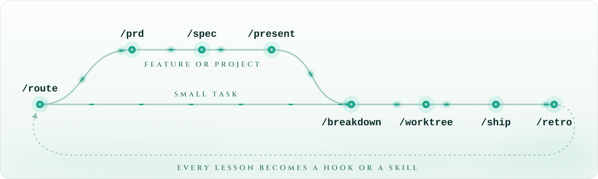

<p align="center">
  <picture>
    <source media="(prefers-color-scheme: dark)" srcset="assets/banner-dark.svg">
    
  </picture>
</p>

<p align="center">
  <b>A Claude Code harness of hooks, agents, and skills, packaged as a plugin marketplace.</b><br>
  Every project gets the same guardrails, checks, and workflow, and improvements land everywhere at once.
</p>

<p align="center">
  <a href="#install"></a>
  <a href="#the-plugins"></a>
  <a href="#maintaining"></a>
  <a href="LICENSE"></a>
</p>

<p align="center">
  <a href="#install">Install</a> ·
  <a href="#what-it-does">What it does</a> ·
  <a href="#the-path-through-the-mist">The path</a> ·
  <a href="#modes">Modes</a> ·
  <a href="#make-it-yours">Make it yours</a> ·
  <a href="#maintaining">Maintaining</a>
</p>

<br>

<p align="center">
  <i>"No one fights alone in the Mist."</i><br>
  <sub>— Senna, the Redeemer</sub>
</p>

<br>

Working with a coding agent is a walk through fog. You can't always see what changed, whether
the tests ran, or whether anyone checked the work before it shipped. **senna** walks through it
with you, so you never ship alone.

## What it does

- **Guardrails** stop force pushes, pushes to protected branches, destructive deletes, discarded
  work, `curl | sh`, and reads of secrets before they run.
- **Edit hooks** format and lint every file the moment it's written, in under two seconds.
- **Stop hooks** run typecheck, build, and tests before Claude stops, only for the languages
  that changed.
- **Review gates** keep a PRD, spec, or task from being marked done without a passing critic or
  reviewer verdict.
- **`/worktree`** gives each task its own worktree, ports, env, and deps, so parallel agents
  never collide.
- **PR stories** explain each change to its reviewer: the problem, the decisions and what they
  beat, and evidence for every claim. `/ship` has the reviewer check each claim against the code,
  and the decision log records each choice as it's made, so the why outlives the session.
- **`/vet`** reviews a PR or branch in one report: its story, bugs and tests, the project's
  decision records (`docs/adr/`, standing rules every session sees), and whether the code
  follows what its dependencies' docs say today, for the versions it uses and the latest ones.
- **`/retro`** turns each session's lessons into hooks and skills. Anything that goes wrong twice
  becomes a rule, so the harness gets stronger with every project.

Around those: session context at startup, handoffs that survive a restart, explorer, reviewer,
and debugger agents, and an optional phone alert when Claude needs you.

## The plugins

| Plugin | For | What it brings |
|---|---|---|
| `core` | every project | session context, guardrails, review gates, handoffs, the retro loop, decision records; explorer, reviewer, best-practices, and debugger agents; `/breakdown` `/worktree` `/ship` `/vet` `/adr` `/handoff` `/retro` `/test-audit` |
| `plan` | features, projects | intake router, `/prd`, `/spec` with competing designs, reviewer lenses, `/present` review decks, `/feedback`; requirement IDs traced from PRD to task to test |
| `lang-ts` | React, Next, Expo | format + lint on edit, typecheck (+ tests) on stop |
| `lang-go` | Go | gofmt on edit, build + vet (+ tests) on stop |
| `lang-rust` | Rust | rustfmt on edit, clippy (+ tests) on stop, perf workflow skill |
| `ops` | services | security-auditor agent, `/triage` via Sentry MCP, API contracts skill |
| `pr-story` | pull requests (opt-in) | PR descriptions and reviews told as a story, with evidence for every claim; author and reviewer modes, per-change checklists, and a facts script for size, tags, and refs |
| `decision-log` | any branch (opt-in) | each decision in its own file as it's settled, reloaded every session and after compaction; a check at each stop for one that wasn't logged (about 3s); `/decide` |
| `lang-template` | other stacks | copy it to add Python, Java, Kotlin, Swift... (not listed in the marketplace) |

## Install

You need `git`, `jq` (hooks skip with a warning without it), and `bash`. `gh`, `lsof`, and your
usual toolchains (`node`, `go`, `cargo`) are optional.

In Claude Code, once per machine:

```
/plugin marketplace add rembrandtreyes/senna
/plugin install core@senna
/plugin install plan@senna
/plugin install lang-ts@senna
```

> [!NOTE]
> Installed plugins are a cached copy. After pushing harness changes, run
> `/plugin marketplace update senna`. Installed under the old name `my-harness`? Run
> `/plugin marketplace remove my-harness`, then the four commands above.

Then set up your machine and each project:

1. **Global:** copy `templates/global-CLAUDE.md` to `~/.claude/CLAUDE.md` and make it yours.
2. **Per project:**
   - copy `templates/project-settings.json` to `<project>/.claude/settings.json` and turn on the
     language plugins that project uses (and `plan` if it uses the planning pipeline, and
     `pr-story` or `decision-log` if you want them). Commit it, and the plugins install
     automatically for anyone who trusts the repo.
   - copy `templates/project-CLAUDE.md` to `<project>/CLAUDE.md` and fill it in
   - append `templates/gitignore-snippet.txt` to `.gitignore`
   - `mkdir tasks .harness`

Forking it? Change the repo in `templates/project-settings.json` and the author names.

## The path through the Mist

<p align="center">
  <picture>
    <source media="(prefers-color-scheme: dark)" srcset="assets/path-dark.svg">
    
  </picture>
</p>

```
/route            classify the request: bug → debugger, small task → /breakdown, feature → /prd
/prd              requirements interview → specs/<slug>/prd.md, gated by the prd-critic
/spec             2–3 rival designs in parallel → spec.md + ADRs, gated by the spec-critic
/present          review deck for humans; /design-review and /feedback close the loop
/breakdown <idea> explorer agents map the code, then task files in tasks/ with acceptance criteria
/worktree T-3 T-4 one worktree per independent task (unique ports, env copied, deps installed)
  ...implement... hooks format and lint every edit and verify at every stop
/ship             checks, then reviewer + security-auditor in parallel, fix blockers, open the PR
/vet 42           review a PR (or a branch): story, bugs, decision records, current practice
/handoff          before stopping mid-task (loaded automatically next session)
/retro            capture lessons; anything recurring becomes a skill, a hook, or an /adr record
/test-audit       quarterly: classify recent fix commits by the test layer that would have caught them
```

The full planning design is in [docs/planning-pipeline.md](docs/planning-pipeline.md).

## Modes

| Mode | Set by | Edit hooks | Stop hooks | Extra guards |
|---|---|---|---|---|
| `interactive` (default) | nothing | format + lint | typecheck/build only, blocks once | — |
| `parallel` | `worktree.sh` writes `.harness/mode` | same | + tests, up to 3 retries | progress log, no push from main, no publish/sudo |
| `auto` | `HARNESS_MODE=auto claude` | same | + tests, up to 3 retries | same as parallel |

Stop hooks only run for languages whose files actually changed, so a TS-only change never waits
on `cargo test`. In every mode they also ask once when source files changed and no test did
(skipped in projects with no tests yet; `HARNESS_TEST_NUDGE=off` turns it off), and Claude either
adds a test or says why none is needed. Once the retry budget is spent, the harness hands control
back to you instead of looping. Tune it with `HARNESS_MAX_STOP_RETRIES`,
`HARNESS_GO_TEST_FLAGS=-race`, and `HARNESS_CLIPPY_FLAGS="-D warnings"`.

**Review gates.** Critics and the reviewer end their output with `REVIEWED: <path>` and
`VERDICT: ...`, and a SubagentStop hook records each verdict in `.harness/verdicts/` with a hash
of what was reviewed. Stop hooks then block once (per version) when a step finished without its
check: a PRD or spec marked `in review` or `approved` with no critic PASS for its current content
(plan), or a task marked `review` or `done` with no reviewer verdict (core). Turn them off with
`HARNESS_STEP_GATE=off` / `HARNESS_REVIEW_GATE=off`.

**Unattended runs.** Copy `templates/settings.local.auto.json` to
`<project>/.claude/settings.local.json` so routine commands don't stall on permission prompts.
It lets `/ship` push the current feature branch (`git push -u origin HEAD`) and open a PR; the
guard still blocks force pushes and pushes to protected branches. Set
`HARNESS_NTFY_TOPIC=<topic>` to get "Claude needs you" alerts on your phone through ntfy.sh.

## Make it yours

**Any build system, no fork.** Drop executable scripts in a project's `.harness/checks/` to
replace a plugin's defaults for that project:

| File | Replaces |
|---|---|
| `ts-edit.sh <file>` / `ts-stop.sh` | lang-ts hooks |
| `go-edit.sh <file>` / `go-stop.sh` | lang-go hooks |
| `rust-edit.sh <file>` / `rust-stop.sh` | lang-rust hooks |

A non-zero exit means the check failed, and the output goes to Claude. `HARNESS_MODE` is set for
you. See `templates/harness-checks/ts-stop.sh` for an Nx example.

**Boundaries.** `.harness/checks/boundaries.txt` (not a script) lists the places where mocks tend
to disagree with reality, each with the tests that hit the real dependency:
`supabase/migrations/* => tests/integration/*`. When a boundary changes and none of those tests
did, the core Stop hook warns you (it never blocks). See `templates/harness-checks/boundaries.txt`.

**Banned commands.** Add project-specific bans, one regex per line, in
`.harness/blocked-commands.txt`.

**A new language.** Copy `plugins/lang-template`.

### Taking it to a new job

The parts that are *you* travel, and the parts that are *theirs* plug in.

> [!IMPORTANT]
> **Check the policy first.** Plugins run shell hooks on your machine and send code to a model.
> Confirm your employer allows Claude Code and third-party plugins on company repos before you
> enable anything.

1. **Keep this repo personal.** Never commit employer code, internal URLs, secrets, or
   proprietary conventions here.
2. **Create a company marketplace** in their GitHub org by copying `core` plus the relevant
   `lang-*` plugins. Add a `company` plugin with their conventions, CI commands, and internal MCP
   servers. Teammates install from there, and changes go through their review.
3. **Map their build system** with `.harness/checks/` overrides (Bazel, Gradle, Nx, Turborepo...)
   rather than editing the language plugins.
4. **Promote generic improvements back** to your personal repo only if they contain nothing
   company-specific.

## Maintaining

- Edit hook helpers in `shared/common.sh`, then run `scripts/sync-common.sh`.
- Run `scripts/validate.sh` before pushing. It checks JSON, bash syntax, executability, synced
  copies, versions, and frontmatter, and runs the fixture tests in `scripts/tests/`.
- Bump `version` in both `plugin.json` and `marketplace.json` when you change a plugin.
- Grow the harness from failures: when something goes wrong twice, `/retro` should turn it into
  a hook (must always happen) or a skill (knowledge).

While developing the harness, skip the install and load plugins straight from this checkout, one
flag per plugin:

```sh
claude --plugin-dir /path/to/senna/plugins/core --plugin-dir /path/to/senna/plugins/plan
```

Run `/reload-plugins` after editing hooks or agents. Skill edits apply immediately.

<details>
<summary><b>Repository layout</b></summary>

```
.claude-plugin/marketplace.json   lists the plugins
plugins/
  core/           every project: session context, guardrails, handoffs, retro loop,
                  explorer/reviewer/best-practices/debugger agents, /breakdown /ship /vet
                  /adr /retro /handoff /worktree
  plan/           planning pipeline: router, /prd, /spec, reviewers, /present, /feedback
  lang-ts/        React/Next/Expo: format+lint on edit, typecheck(+tests) on stop
  lang-go/        gofmt on edit, build+vet(+tests) on stop
  lang-rust/      rustfmt on edit, clippy(+tests) on stop, perf workflow skill
  ops/            security-auditor agent, /triage via Sentry MCP, api-contracts skill
  pr-story/       PR descriptions and reviews told as a story, evidence for every claim (opt-in)
  decision-log/   a file per decision, reloaded each session, checked at each stop (opt-in)
  lang-template/  copy to add Python, Java, Kotlin, Swift... (not listed in marketplace)
shared/common.sh  canonical hook library (synced into each plugin)
architecture/     LikeC4 model of this repo (npm run arch to browse, arch:validate to check)
docs/             planning-pipeline.md: the planning design (PRD → spec → present → review → build);
                  adr/: this repo's decision records
templates/        global + project CLAUDE.md, settings, gitignore, override examples
scripts/          sync-common.sh, validate.sh, tests/ (the fixture tests validate.sh runs)
assets/           README banner and diagram (light + dark), social-preview.png
```

</details>

<br>

<p align="center">
  <sub>Named for Senna, the Redeemer, from League of Legends. A fan homage, not affiliated with or endorsed by Riot Games.</sub>
  <br>
  <sub><a href="LICENSE">MIT License</a> · built in the Mist by <a href="https://github.com/rembrandtreyes">@rembrandtreyes</a></sub>
</p>
